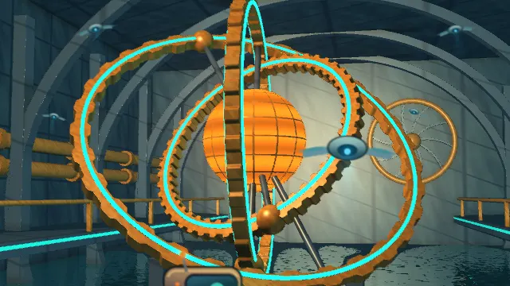

# Wildframe

Wildframe is a Rust and egui studio for animated procedural wallpapers. The seven scenes, from Alpine Lake to Tidal Engine, render on the GPU from editable WGSL.



## Run

```powershell
cargo run --release --locked
```

- **Studio** lets you shuffle the seed, set lighting and camera controls, play or pause the motion, and enter a frame time in seconds.
- **Story** plays *The Last Light*, a 30-minute, eight-chapter trip with Mica the rover and Kite the drone. The Tidal Engine chapter starts at 20:30. Jump between 25 authored shots with **Previous shot** and **Next shot**, or scrub the timeline. Playback speeds go up to 60×.
- **Render effects** switches clouds, reflections, particles, cast shadows, film grain, story camera cuts, and supporting actors independently. Effects apply where the scene uses them.
- **Save frame as PNG** exports the current frame. Available formats include 4K UHD, ultrawide, and portrait.

## Add or edit scenes and chapters

Edit or duplicate a file in [scenes/](scenes/) and press **F5** or click **Reload files**. Every scene defines `fn scene(film: vec2f) -> vec3f`. The optional `// name:` and `// description:` headers supply the display text. The shared uniforms are `p.seed`, `p.time` in seconds, and `p.light`, `p.color`, `p.camera`, and `p.detail` from 0 to 1. See [common.wgsl](src/common.wgsl) for color, noise, and effect switches.

Edit [scenes/story.json](scenes/story.json) to rearrange chapters, choose scene IDs, adjust durations and light, or change the timed captions. Each chapter can use an `action` from the bundled example to direct the characters, or omit the action for scenery alone. Reload applies scene and story edits in the running app. The executable embeds the defaults and looks for editable files in a `scenes` directory alongside it when moved out of the project.

Each caption cue can specify a `camera` with `from` and `to` triples of horizontal center, vertical center and zoom. The move eases between them until the next cue cuts to its starting frame. A zoom of 1 uses the full frame. The limit is 4. Omitting the camera uses the original wide view.

The character drawings, flock formations, service drones, moving cell, and signal relays live in [scenes/shared/cast.wgsl](scenes/shared/cast.wgsl). Press **F5** after editing it. To see the chamber alone, open **Studio → Tidal Engine → Play motion**.

## Render from a terminal

```powershell
cargo run --release --locked -- --render neon-passage 915 3840 2160 tunnel.png 12.5
cargo run --release --locked -- --story 1435 1920 1080 return-line.png
```

The optional last argument to `--render` is the scene time. `--story` takes an absolute story time in seconds.
